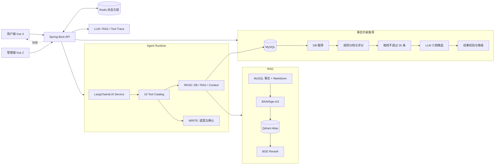

# 408 考研择校决策平台

基于事实约束的 AI 考研择校 Agent，将结构化招生数据、规则推荐、Tool Calling 与版本化 RAG 组合成可解释、可追踪的择校工作台。

[](https://openjdk.org/)
[](https://spring.io/projects/spring-boot)
[](https://docs.langchain4j.dev/)
[](https://qdrant.tech/)
[](./LICENSE)

- 在线体验：[https://408lab.site](https://408lab.site)
- 管理端入口：[https://408lab.site/admin/](https://408lab.site/admin/)
- RAG 运维：[RAG / Qdrant 运维说明](./docs/RAG-Qdrant-运维说明.md)
- 系统原理：[AI 推荐 Agent 全链路与可观测性](./docs/AI推荐Agent全链路与可观测性说明.md)

> 本项目用于考研信息辅助分析，推荐结果不能替代院校官方招生简章、专业目录和个人决策。

## 项目概览

平台围绕考研择校中的三个实际问题构建：

1. **推荐不能脱离真实数据。** MySQL 和规则层负责筛选、分档与排序，LLM 只在受控候选池内精选和解释。
2. **AI 操作必须可控。** 16 个领域 Tool 统一经过预算、错误协议、确认机制和 Trace 治理。
3. **答案需要证据。** 招生事实与通用知识构建为 Qdrant 知识库，通过 Metadata Filter、向量召回和 BGE Rerank 提供引用依据。

当前数据覆盖 486 所院校、2,000+ 个计算机相关专业方向及 6,000+ 条历年招生数据，支持用户画像、候选池生成、自然语言调整和推荐报告。

## 核心亮点

### 事实约束 Agent

数据库粗筛与 Java 规则引擎先构建冲刺、稳妥、保底候选池，每档最多向 LLM 提供 30 条事实卡。模型返回的专业 ID 必须属于候选池，并经过空值、池外 ID、重复项、数据完整度和档位上限校验；模型异常时回退到规则排序结果。

### Agent Tool Runtime

当前 Tool Catalog 注册 16 个 Tool（9 READ / 7 WRITE），统一声明预算组、结果规模、确认要求和并发属性。Runtime 负责调用预算、标准结果码、异常脱敏和 MySQL Tool Trace，避免治理规则散落在各个 `@Tool` 方法中。

### 安全写操作

模型不能直接修改用户草稿。写 Tool 先生成绑定用户、`runId` 和草稿版本的操作提案；用户确认后，后端通过 Redis Lua 原子消费一次性令牌，再执行真实修改，防止重复确认和过期提案覆盖新草稿。

### 版本化 RAG

MySQL 招生事实与通用 Markdown 被组织为带 Metadata 的语义 Chunk。索引重建先写入候选 Collection，校验后再原子切换 `postgrad_rag_active` Alias，避免在线查询读取半成品。检索链路为：

```text
Query -> Metadata Filter -> Dense Vector Retrieval -> BGE Rerank -> Top-K Evidence -> LLM / Citation
```

当前实现不是 BM25 + Dense Hybrid Search。

### 长任务与可观测性

三档推荐使用 `CompletableFuture` 并行调用，Redis 保存任务状态、锁和草稿快照，SSE 增量推送进度、Token、Tool 与确认事件。一次对话通过 `runId` 关联 LLM 调用、RAG Trace、Tool Trace 与 SSE 事件，管理端可查看过滤条件、候选排名和阶段耗时。

### RAG 评测工作台

管理端提供持久化 RAG 评测工作台，用 MySQL 管理可编辑 DEV、不可变 FROZEN 和独立 SAFETY 数据集。管理员可以维护 Ground Truth、从持久化 Trace 创建待审核用例、运行 Vector Only / Vector + Rerank 消融、查看逐用例排名与技术错误、对比兼容 Run，并导出 JSON 或 Markdown 报告。冻结时使用稳定排序与 SHA-256 生成可审计 JSONL 快照。

## 系统架构



## 产品能力

### 用户端

- 用户画像：估分、地区、院校层次、风险偏好与考试信息。
- 智能推荐：生成冲刺 3 所、稳妥 4 所、保底 3 所的候选草稿。
- AI 对话：查询、对比、解释推荐理由和风险，或提出草稿调整。
- 证据引用：展示专业级历史数据、趋势、来源与数据质量证据。
- 报告生成：输出画像依据、候选分析、风险提示与数据来源。
- 会话恢复：聊天记录、任务状态和草稿可在刷新后恢复。

### 管理端

- 学校、学院、专业及历年招生数据维护。
- 数据质量、来源追踪和审核工作台。
- RAG 索引运行、活动 Alias、检索测试与 RAG Trace。
- RAG 评测数据集、后台实验、回归对比、人工诊断与报告导出。
- AI 调用指标和 Tool Trace 查询。
- 用户、角色、菜单、日志等系统管理能力。

## 技术栈

| 领域 | 技术 |
|---|---|
| 后端 | Java 17、Spring Boot 4、Spring Security、MyBatis |
| AI 应用 | LangChain4j、DeepSeek、Tool Calling、SSE |
| RAG | BAAI/bge-m3、BGE Rerank、Qdrant |
| 数据 | MySQL 8、Redis、RabbitMQ |
| 用户端 | Vue 3、Vite、Pinia、Element Plus |
| 管理端 | Vue 2、Vue CLI、Vuex、Element UI |
| 工程化 | Maven、Docker Compose、Nginx |

## 快速开始

### 1. 环境要求

- JDK 17+
- Maven 3.9+
- MySQL 8+
- Redis 6+
- Node.js 18+
- Docker Desktop 或可用的 Docker Engine

RabbitMQ 仅用于相关异步业务；运行 AI 推荐与 RAG 的最小环境需要 MySQL、Redis 和 Qdrant。

### 2. 初始化数据库

创建数据库：

```sql
CREATE DATABASE postgrad_selector
  DEFAULT CHARACTER SET utf8mb4
  COLLATE utf8mb4_unicode_ci;
```

数据库入口脚本位于 [`sql/`](./sql/)。全新环境按以下固定顺序导入：

```text
sql/00_platform_bootstrap.sql
sql/10_postgrad_core_schema.sql
sql/20_ai_runtime_schema.sql
sql/30_postgrad_menu_permissions.sql
```

其中 `00_platform_bootstrap.sql` 和 `10_postgrad_core_schema.sql` 包含 `DROP TABLE`，只允许用于空库初始化或明确批准的全量重建，不能用于生产环境增量升级。

业务数据导入后，可按需执行 `sql/90_data_quality_maintenance.sql` 刷新专业年度数据质量。历史迁移和一次性修复保存在 `sql/archive/`，不属于常规安装步骤。

### 3. 配置环境变量

PowerShell 示例：

```powershell
$env:MYSQL_USERNAME = "root"
$env:MYSQL_PASSWORD = "your-mysql-password"
$env:REDIS_PASSWORD = "your-redis-password"
$env:JWT_SECRET = "replace-with-a-long-random-secret"

$env:DEEPSEEK_API_KEY = "your-deepseek-api-key"
$env:SILICONFLOW_API_KEY = "your-siliconflow-api-key"

$env:QDRANT_URL = "http://localhost:6333"
$env:QDRANT_HOST = "localhost"
$env:QDRANT_GRPC_PORT = "6334"
$env:QDRANT_COLLECTION = "postgrad_rag_active"
```

Linux/macOS 使用同名环境变量。不要把真实密钥写入仓库或前端环境文件。

### 4. 启动基础服务

```bash
docker compose up -d qdrant rabbitmq
```

检查 Qdrant：

```bash
curl http://localhost:6333/healthz
curl http://localhost:6333/aliases
```

Qdrant Dashboard：<http://localhost:6333/dashboard>

### 5. 启动后端

```bash
mvn clean package -DskipTests
java -jar ruoyi-admin/target/ruoyi-admin.jar
```

后端默认地址：<http://localhost:8080>

### 6. 启动两个前端

管理端：

```bash
cd ruoyi-ui
npm install
npm run dev
```

访问 <http://localhost:8081>。

用户端：

```bash
cd user-ui
npm install
npm run dev
```

访问 <http://localhost:8082>。

## 首次 RAG 初始化

后端启动不会自动清空或重建知识库。首次使用时：

1. 登录管理端。
2. 进入“数据运维 / RAG 观测台”。
3. 选择招生数据年份范围，创建完整知识库构建任务。
4. 等待状态变为 `SUCCEEDED`。
5. 确认活动 Alias 指向新版本 Collection。
6. 使用检索测试验证学校、专业和年份过滤。

完整流程见 [RAG 全链路验收清单](./docs/RAG-全链路验收清单.md)。

## 最小验收

### 服务状态

```bash
curl http://localhost:8080/captchaImage
curl http://localhost:6333/healthz
curl http://localhost:6333/aliases
```

### 产品流程

- 用户端可以注册、填写画像并生成三档候选草稿。
- AI 对话可以查询学校详情，并对写操作弹出确认步骤。
- 管理端 RAG 观测台显示 Qdrant 可达、已索引和活动 Collection。
- 检索测试返回 Metadata Filter、召回数、Rerank 结果和阶段耗时。
- AI 观测台可以按 `runId` 查看 Tool Trace。

## 项目结构

```text
postgrad_selector/
├── ruoyi-admin/       # 应用入口、Controller 和运行配置
├── ruoyi-postgrad/    # 推荐、Agent Tool Runtime、RAG 与业务领域
├── ruoyi-framework/   # 安全、Redis、线程池和框架配置
├── ruoyi-system/      # 用户、角色、菜单等系统域
├── ruoyi-common/      # 公共类型与工具
├── ruoyi-quartz/      # 定时任务
├── ruoyi-generator/   # 代码生成器
├── ruoyi-ui/          # Vue 2 管理端
├── user-ui/           # Vue 3 用户端
├── sql/               # 初始化与增量 SQL
├── docs/              # 架构、运维、验收和面试文档
└── docker-compose.yml # Qdrant 与 RabbitMQ 本地环境
```

## 测试与 RAG 评测

后端测试：

```bash
mvn -pl ruoyi-postgrad -am test
```

前端构建验证：

```bash
cd user-ui && npm run build
cd ../ruoyi-ui && npm run build:prod
```

RAG 评测包含：

- `DEV`：可编辑的日常回归用例；
- `FROZEN`：带 SHA-256 的不可变版本，用于可比较实验；
- `SAFETY`：单独统计 No-answer Accuracy 与 False Positive Rate；
- `VECTOR_ONLY` / `VECTOR_RERANK`：在相同数据集和参数快照下进行消融；
- 每次 Run 持久化数据集校验和、Qdrant Alias/Collection、模型、参数、Git commit、逐用例结果和阶段延迟。

管理端权限为 `postgrad:ragEval:view/edit/run/freeze/compare/export`。本阶段不包含 BM25 混合召回、知识文档上传和 LLM-as-judge；评测工作台只验证现有 Dense Retrieval + Metadata Filter + BGE Rerank 链路。

- 63 条开发集，用于迭代和 bad case 分析。
- 36 条 `frozen-v3` 排序集，不参与原地调参。
- 12 条 `safety-v3` No-answer 安全集。
- Vector Only 与 Vector + BGE Rerank 消融。
- MRR、Hit@K、Recall@K、nDCG、Filter Accuracy、No-answer Accuracy、FPR 和阶段延迟。

一次本地 frozen 消融中，Rerank 将 MRR 从 `0.593` 提升至 `0.639`、Hit@1 从 `44.4%` 提升至 `50.0%`，同时总延迟 P50 从 `152 ms` 增加至 `284 ms`。该结果样本量较小，用于工程回归，不代表线上 SLA。

历史本地全量索引批次曾生成 3,581 份逻辑文档、21,461 个 Chunk；实际活动索引数量取决于当前数据和构建年份范围。

## 文档

| 文档 | 内容 |
|---|---|
| [AI 推荐 Agent 全链路与可观测性](./docs/AI推荐Agent全链路与可观测性说明.md) | 推荐、Tool、RAG、SSE 和 Trace 全链路 |
| [RAG / Qdrant 运维说明](./docs/RAG-Qdrant-运维说明.md) | 启动、索引、Alias、检索与排障 |
| [RAG 全链路验收清单](./docs/RAG-全链路验收清单.md) | 数据生成、索引、检索、引用和观测验收 |
| [AI 推荐链路完整文档](./docs/AI推荐链路完整文档.md) | 候选池、规则分档与 AI 精选 |
| [数据库设计文档](./docs/考研择校平台数据库设计文档-MVP.md) | 核心表结构和关系 |
| [AI 应用开发面试深挖手册](./docs/丁宇涵-AI应用开发面试深挖手册.md) | 项目追问、AI 八股和系统设计 |

## 当前边界

- 项目以单体 Spring Boot 应用为主，不是多 Agent 或分布式工作流平台。
- RAG 使用 Dense Vector + Metadata Filter + Rerank，尚未接入 Sparse/BM25 混合召回。
- `runId` 提供领域级调用关联，但当前并非完整 OpenTelemetry 分布式追踪。
- 离线评测集规模有限，指标用于回归和方案比较，不代表真实用户转化效果。
- 推荐结果需要结合当年院校官方信息人工复核。

## License

本项目基于 [RuoYi-Vue](https://gitee.com/y_project/RuoYi-Vue) 进行业务扩展，遵循 [MIT License](./LICENSE)。

## 致谢

- [RuoYi-Vue](https://gitee.com/y_project/RuoYi-Vue)
- [LangChain4j](https://github.com/langchain4j/langchain4j)
- [Qdrant](https://github.com/qdrant/qdrant)
- [DeepSeek](https://www.deepseek.com/)
- [SiliconFlow](https://siliconflow.cn/)
